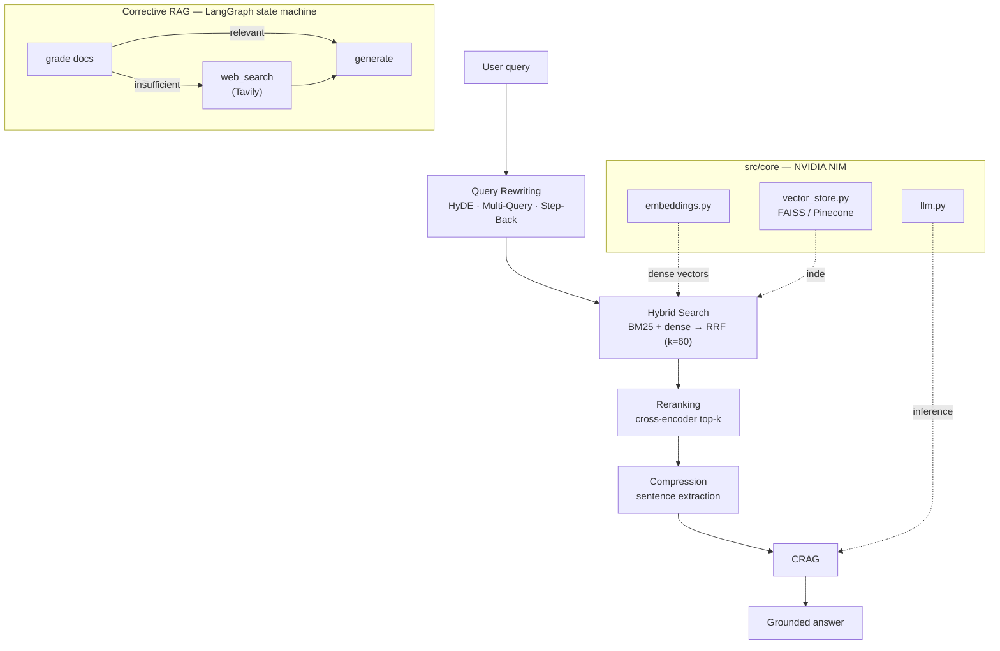

# NVIDIA NIM RAG Techniques

[](https://github.com/shaikn6/nvidia-nim-rag-techniques/actions)
[](https://python.org)
[](LICENSE)
[](https://github.com/astral-sh/ruff)
[](#tests)


**Five production-grade RAG optimization techniques, powered by [NVIDIA NIM](https://www.nvidia.com/en-us/ai/) and orchestrated with LangChain / LangGraph.**

Naive RAG — embed, retrieve top-k, stuff into the prompt — falls over on real corpora: keyword-heavy queries miss, embeddings surface near-duplicates, long contexts bury the answer, and the model has no recourse when retrieval is simply wrong. This repo implements the five techniques that fix each failure mode, each isolated, tested, and benchmarkable against a naive baseline.

---

## The Five Techniques

| # | Technique | Problem it solves | Module |
|---|-----------|-------------------|--------|
| 1 | **Hybrid Search + RRF** | Dense embeddings miss exact terms (tickers, IDs, code) | `src/techniques/hybrid_search.py` |
| 2 | **Cross-Encoder Reranking** | Top-k by cosine returns near-duplicates, not the best answer | `src/techniques/reranking.py` |
| 3 | **Query Rewriting** (HyDE · Multi-Query · Step-Back) | Short/ambiguous queries retrieve poorly | `src/techniques/query_rewriting.py` |
| 4 | **Context Compression** | Long contexts bury the signal and waste tokens | `src/techniques/compression.py` |
| 5 | **Corrective RAG (CRAG)** | Retrieval is sometimes wrong with no fallback | `src/techniques/corrective_rag.py` |

- **Hybrid Search** fuses BM25 (lexical) and dense vector scores via Reciprocal Rank Fusion.
- **Reranking** scores each candidate against the query with a cross-encoder, then keeps the true top-k.
- **Query Rewriting** generates a hypothetical answer (HyDE), multiple query variants, and a step-back abstraction.
- **Compression** extracts only the query-relevant sentences before they reach the LLM, either via an LLM extraction call or an embedding-similarity filter (no LLM call).
- **Corrective RAG** grades retrieved docs with a LangGraph state machine and falls back to web search (Tavily) when they're insufficient.

---

## Architecture

The diagram below is an illustrative retrieve → refine → ground flow showing where
each technique sits. It is not a single shipped pipeline: the benchmark runs six
separate pipelines (the naive baseline plus one adapter per technique, with query
rewriting represented by HyDE), and no pipeline chains all five stages. Each stage is
independently testable and can be timed in isolation against the naive baseline.



- **`src/core/`** — NVIDIA NIM LLM client (`llm.py`), embeddings (`embeddings.py`), FAISS/Pinecone vector store (`vector_store.py`)
- **`src/techniques/`** — the five techniques, each behind a common interface
- **`src/pipeline/`** — composable pipeline (`base.py`) and a benchmark harness (`benchmark.py`) that times each technique against the naive baseline

### How it works

- **Reciprocal Rank Fusion.** Hybrid search merges the BM25 and dense rank lists
  with `RRF(d) = Σ 1 / (k + rank_i(d))`, `k=60` — rank-based fusion that needs no
  score normalization between the two retrievers (`reciprocal_rank_fusion` in
  `hybrid_search.py`).
- **Corrective RAG as a graph.** `build_crag_graph` wires a LangGraph
  `StateGraph`: `retrieve → grade → {generate | web_search → generate} → END`.
  A conditional edge routes to the Tavily web-search fallback only when graded
  documents are insufficient, so the model is never forced to answer from bad
  context.
- **Benchmark methodology.** `run_benchmark` runs each pipeline over a shared
  query set, capturing per-run latency (`time.perf_counter`) and exceptions;
  `BenchmarkReport.summary()` aggregates `avg_latency_ms`, `error_rate`, and
  `query_count` per technique, so latency and failure rate are measured against the
  naive baseline rather than asserted. This latency benchmark does **not** measure
  retrieval or answer quality; retrieval quality (recall@k, MRR) is measured separately
  on a small labeled set, see [Retrieval quality](#retrieval-quality) below. There is
  still no answer-correctness metric. Absolute latency numbers depend on your NIM
  endpoint, corpus, and query set — run it on yours.

### Example output

Without a real `NVIDIA_NIM_API_KEY` configured, `python -m src.pipeline.benchmark`
falls back to the bundled `DemoLLM` / `DemoEmbeddings` stand-ins and a small
in-memory corpus (`src/pipeline/demo_data.py`), so the pipeline is fully
exercised end-to-end with no network calls. Actual output from a local run:

```
Benchmark: 6 pipelines x 4 queries

          naive_baseline  avg_latency_ms=0.39  error_rate=0.00  query_count=4
           hybrid_search  avg_latency_ms=0.12  error_rate=0.00  query_count=4
               reranking  avg_latency_ms=0.07  error_rate=0.00  query_count=4
    query_rewriting_hyde  avg_latency_ms=0.04  error_rate=0.00  query_count=4
             compression  avg_latency_ms=0.25  error_rate=0.00  query_count=4
          corrective_rag  avg_latency_ms=23.00  error_rate=0.00  query_count=4
```

All six pipelines complete with `error_rate=0.00`, confirming the naive
baseline and all five technique adapters run end-to-end. These are demo-mode
timings (in-memory stand-ins, not real NIM inference), so treat them as a
sanity check that the harness works, not as a performance claim — `corrective_rag`
is consistently the slowest because it's the only pipeline that runs an
LLM-based document grading step through the LangGraph state machine before
generating. Run it against your own NIM endpoint and corpus for numbers that
mean something.

---

## Retrieval quality

`src/pipeline/retrieval_eval.py` scores each pipeline's ranked `sources` against labeled
relevance judgments (recall@k, MRR@5). It uses real local models, no NIM key needed:
`BAAI/bge-small-en-v1.5` embeddings and the repo's default `BAAI/bge-reranker-v2-m3`
cross-encoder. Generation is a no-op stub; only retrieval is scored.

**Data:** `eval/data/tiny_ir.json`, 48 short technical passages in 12 topic clusters
(four passages per topic, so each cluster holds hard negatives) and 28 queries with gold
passage ids (2 queries have two gold passages). 13 queries are `lexical` (share distinctive
terms with the gold passage), 15 are `paraphrase` (same fact, different words). It was
authored for this repo (MIT); each query was written from its gold passage and the labels
were fixed before any pipeline was run.

```bash
python -m src.pipeline.retrieval_eval   # writes eval/retrieval_results.json
```

Measured (28 queries, k = number of returned passages considered):

| Pipeline | recall@1 | recall@3 | recall@5 | MRR@5 |
|----------|---------:|---------:|---------:|------:|
| naive baseline (dense) | 0.857 | 1.000 | 1.000 | 0.946 |
| hybrid search (BM25 + dense, RRF) | 0.893 | 0.946 | 1.000 | 0.955 |
| cross-encoder reranking | 0.964 | 1.000 | 1.000 | 1.000 |
| compression (embeddings filter) | 0.857 | 1.000 | 1.000 | 0.946 |

Reading it honestly:

- **This set is tiny and easy.** Dense retrieval already finds every gold passage in the
  top 3, so differences are a handful of queries at rank 1-3, not statistically meaningful.
  recall@1 tops out at 0.964 because two queries have two gold passages.
- **Reranking** put the gold passage first on every query that has one gold passage.
  Its edge is on the `paraphrase` queries (recall@1 0.933 vs 0.733 for dense).
- **Hybrid search** helped recall@1 slightly (0.893 vs 0.857) but lost on recall@3
  (0.946 vs 1.000): on two paraphrase queries BM25 pushed a gold passage down to rank 4-5.
  On `lexical` queries every pipeline is already at 1.000. The BM25 tokenizer here is
  `lower().split()`, so punctuation stays attached to words.
- **Compression** does not change which passages are retrieved or their order, so its
  ranking metrics equal the naive baseline by construction; its benefit is shorter context.
- **Not measured:** `query_rewriting_*` (HyDE, multi-query, step-back) and `corrective_rag`
  need a real LLM (and Tavily for the CRAG fallback), so they are skipped rather than scored
  with a stub. Per-query-type breakdowns are in `eval/retrieval_results.json`.

---

## Quickstart

```bash
git clone https://github.com/shaikn6/nvidia-nim-rag-techniques
cd nvidia-nim-rag-techniques

python -m venv .venv && source .venv/bin/activate
pip install -e ".[dev]"

cp .env.example .env   # add your NVIDIA_NIM_API_KEY
```

```bash
# Run the test suite (95%+ coverage gate)
pytest --cov

# Benchmark latency and error rate of the naive baseline and the five techniques
python -m src.pipeline.benchmark

# Measure retrieval quality (recall@k, MRR) with local embedding + reranker models
python -m src.pipeline.retrieval_eval
```

> **macOS:** if `pytest` crashes with `Fatal Python error: Aborted` while
> importing `torch`/`sentence-transformers`, that's a duplicate-OpenMP-runtime
> conflict between `faiss-cpu` and `torch`, not a repo issue. Work around it
> with `KMP_DUPLICATE_LIB_OK=TRUE pytest --cov`. CI (Ubuntu) is unaffected.

## Configuration

| Variable | Required | Purpose |
|----------|----------|---------|
| `NVIDIA_NIM_API_KEY` | ✅ | NVIDIA NIM inference + embeddings |
| `NVIDIA_NIM_BASE_URL` | optional | NIM endpoint (default `integrate.api.nvidia.com/v1`) |
| `PINECONE_API_KEY` / `PINECONE_INDEX` | optional | Pinecone vector store (FAISS is default) |
| `TAVILY_API_KEY` | optional | Web-search fallback for Corrective RAG |

---

## Tech Stack

LangChain · LangGraph · NVIDIA NIM · FAISS · BM25 (rank-bm25) · sentence-transformers · Pydantic · pytest

## Tests

Every technique has an isolated test module under `tests/`, plus a benchmark test — 135 tests, 99% coverage locally (`pytest --cov`). CI runs lint (ruff) and the full suite with a 95% coverage gate.

## License

MIT
